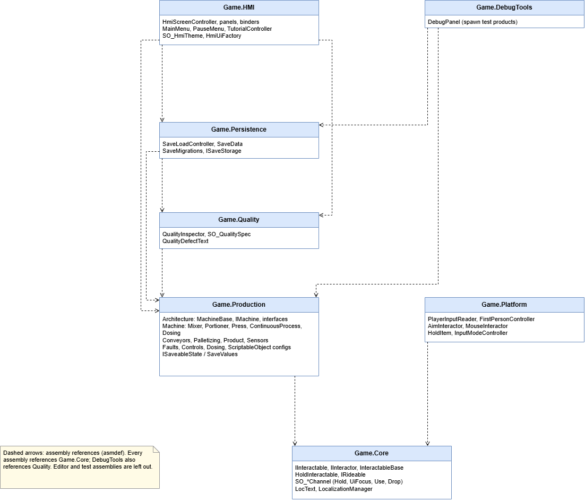
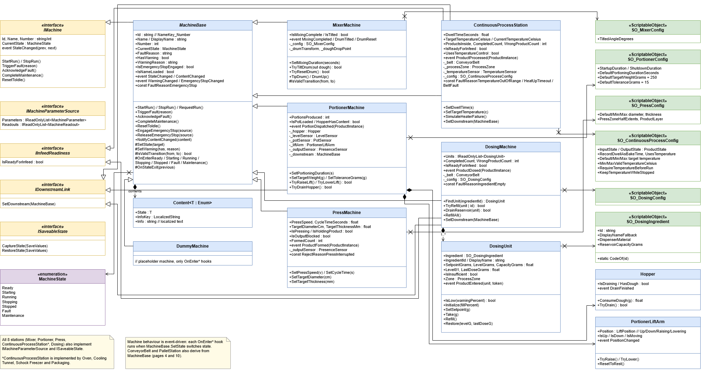

# Assembly-Architektur

Die Codebasis wurde in mehreren Assemblies aufgeteilt, um die Kompilierzeit zu verringern, die Architektur sauber zu trennen.

------------------------------------------------------------------------

# Design-Prinzipien

## Interaktionssystem

Das Interaktionssystem folgt diesen Prinzipien:
- **Komposition statt Vererbung**: IInteractable sitzt auf Maschinenteilen (Knöpfe, Hebel) und HMI-Elementen.
- **Interface-Segregation**:
  - Ein-Member-Interface: IHoldingCustomHint hat genau eine Property. Das Fadenkreuz muss nichts über den Hubwagen wissen, um dessen Hinweis anzuzeigen.
  - IInteractor hat keine Ray-, Maus- oder XR-Typen. Wer interagiert, ist für den IInteractable irrelevant.
- **Dependency Imversion**:
  - Interactables kennen den Interactor nicht.
  - ScriptableObject-Kanäle als Vermittler.
- **Plattformunabhängigkeit über IInteractor**:
  - IInteractor liefert nur CurrentTarget, TargetChanged und TryInteract(). Es gibt keine Maus-, Ray- oder XR-Typen.
  - Game.Core hat keine Abhängigkeit auf die Plattform. Game.Platform referenziert nur Core, Input System und TMP.
  - AimInteractor und MouseInteractor sind austauschbare Implementierungen. Ein XR-Interactor ist vorgesehen, ohne dass sich etwas an den Interactables ändern muss.
- **Event-getrieben statt Polling**: InteractableChanged und TargetChanged feuern nur bei Änderung. Die Interactor-Seite steuert Hover-Enter und Hover-Exit.
- **Template Method (InteractableBase)**:
  - Sie kapselt die Boilerplate für IsInteractable, Events und die leeren Hover-Hooks.
  - Unterklassen überschreiben nur OnInteract(). Der Guard if (!IsInteractable) return; steht zentral in der Basisklasse.
  - Die Basisklasse ist optional. Man kann das Interface auch direkt implementieren.
- **Zielfindung wie physisch plausibel**:
  - Der Strahl geht von der Bildmitte aus und ist auf 3 m begrenzt.
  - Er sortiert die Treffer nach Entfernung und nimmt das erste Interactable, das auf der Interactable-Layer liegt.
  - Feste Collider davor blockieren (Occluder-Mask). Triggers ohne Interactable (Sensoren, Zonen) werden durchschaut.
  - Der eigene Spielerkörper wird ignoriert.
  - Der Treffer wird per GetComponentInParent gesucht, daher dürfen Collider auf Kind-Meshes liegen.
  - Es gibt keine Allokationen: RaycastNonAlloc mit festem Puffer. 
- **Zustandsabhängiger Fokus**: Hält der Spieler ein Objekt (HoldChannel.HoldingObject != null), ist das Aim-Ziel null. Hold und Interaktion schließen sich also gegenseitig aus.
- **Entkopplung über ScriptableObject-Kanäle**: SO_HoldChannel, SO_UseRequestChannel, SO_DropRequestChannel, SO_UiFocusChannel und SO_HoldPoint verbinden Spieler, UI und Maschinen ohne direkte Referenzen.
- **Maschine bewertet, Sensor liefert Rohwerte**: Über IMachineParameterSource stellen Maschinen Sollwerte und Istwerte bereit. Die Maschine bewertet sie als MachineValueLevel (Inactive, Normal, Warning, Alarm), und das HMI bildet das nur auf Farben ab. Das HMI kennt keine konkreten Maschinentypen.
- **Nur neues Input System**: Alles läuft über PlayerInputReader und seine Events, zum Beispiel InteractPerformed.

------------------------------------------------------------------------
## Maschinen-Architektur 

Die Maschinen-Architektur (MachineBase und die Stationen darauf) folgt diesen Prinzipien:
- **Komposition statt Mehrfachvererbung**: IInteractable sitzt auf Maschinenteilen (Knöpfe, Hebel) und HMI-Elementen, nie auf der Maschine selbst.
- **Gemeinsame Basisklasse mit Zustandsautomat**: MachineBase hat eine validierte Übergangstabelle (Ready → Starting → Running → Stopping → Stopped, Störung Fault → Maintenance → Ready) und eine feste API (StartRun(), StopRun(), TriggerFault() …).
- **Interfaces**: IMachineParameterSource (das HMI kennt keine Maschinentypen), IInfeedReadiness, IDownstreamLink, ISaveableState, IProductReceiver, IRideable.
- **Ereignis- und Kanalkommunikation**: StateChanged-Events und ScriptableObject-Channels wie SO_MachineOverviewChannel, über die der Reporter Zustände an das HMI weitergibt.

------------------------------------------------------------------------

